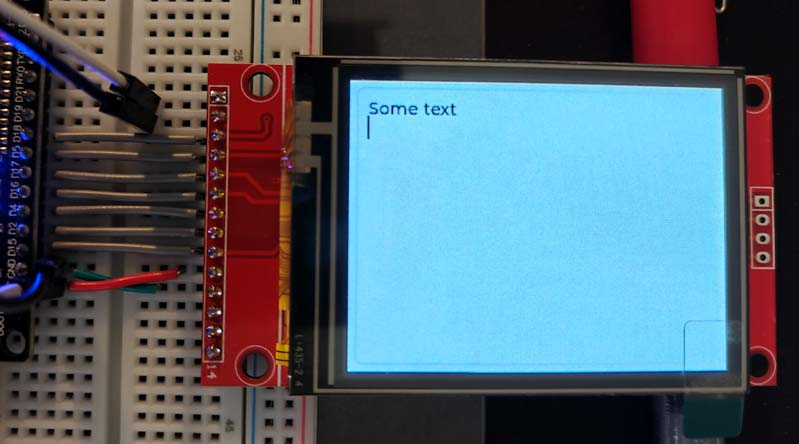
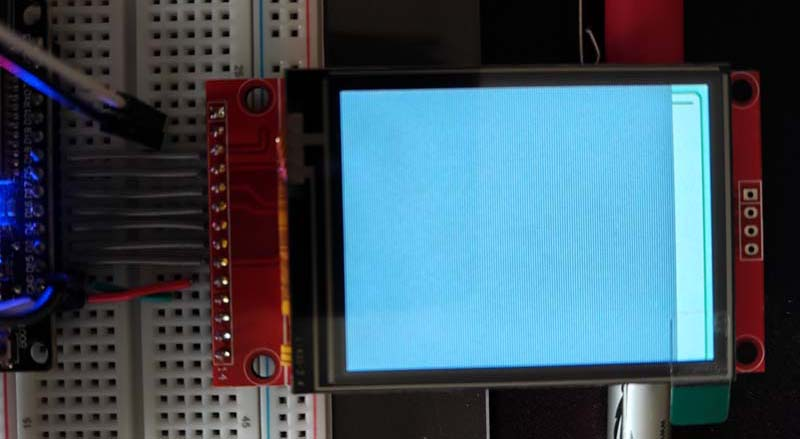

# ILI9341

This is an attempt to use the built in ILI9341 driver provided by LVGL on an ESP32.

This is based on a test program that works when using TFT_eSPI as the driver. It shows this:

I took this as a starting point and modified the code to use the built in ILI9341 driver and ... it doesn't work. The first call to `lv_task_handler()` hangs with only part of the display drawn and the function never returns. The result looks like this:

To make sure that the wiring was fine and that my SPI code was fine I added the code in `TestILI9341.cpp` which writes directly to the display and fills the display with red, then green then blue. This works fine. When I reset the ESP32 I see the screen filled with the three colours as expected, but when LVGL starts writing to the screen it crashes.

[The Espressif documentation for the ILI9341 built in driver is here](https://lvgl.io/docs/open/integration/external_display_controllers/ili9341).