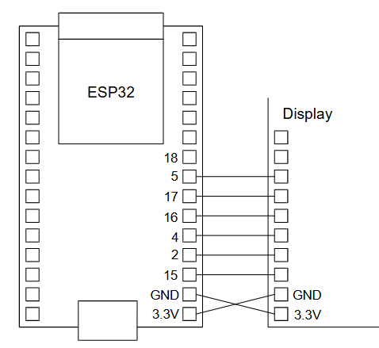
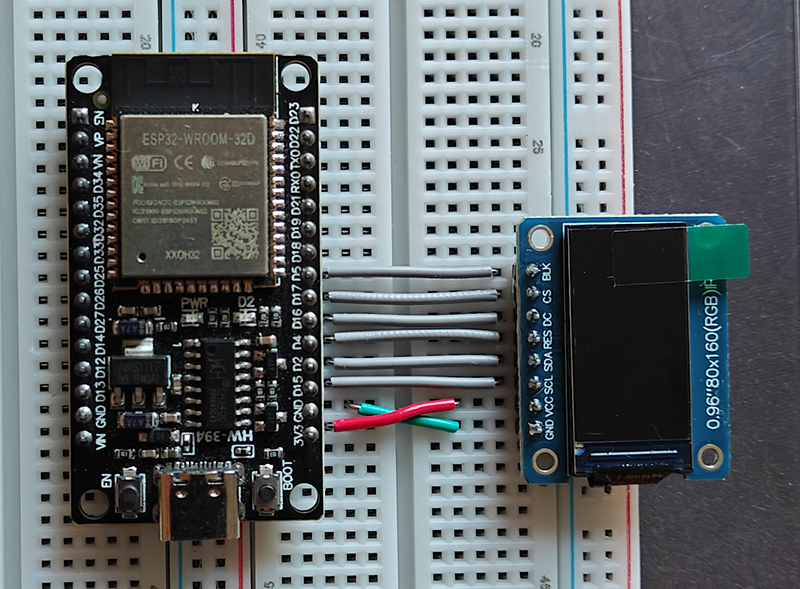

# Display examples

This directory holds examples of how to use displays with the ESP32. There is code demonstrating the use of several graphics libraries. See the various subdirectories for the details.

SPI displays require a total of eight wires including the backlight and MISO wires (not all displays require the MISO and backlight connections) and this is a lot of wires. I used a basic ESP32 dev board for the examples and this has the 3.3V and GND pins at the bottm right corner so it was convenient to wire the SPI display like this:

This is an example wired using a breadboard:

This wiring dictates the GPIO pin numbers used in my examples. On an ESP32 any pins can be used for SPI so you are free to use whatever wiring is convenient for your board. Just change the pin number #defines in the code.

## Libraries

Examples are provided using the Arduino_GFX, TFT_eSPI and Loyan libraries.

Arduino_GFX is simple to use but it is significantly slower than TFT_eSPI and Lovyan.

## Boards tested

### GC9A01

This is a popular and widely used round display.

### ILI9341

Possibly the most common display for the 240 x 320 resolution.

### ILI9488

A 320 x 480 display.

### SSD1306

An entry level small monochrome OLED display. Unlike the other displays this uses an I2C bus not an SPI bus.

### ST7735

This tends to be used for small SPI displays and it comes in a range of sizes and resolutions.

### ST7789

Very similar to the ILI9341. It's usually used for 240 x 320 displays though the one I tested here was 240 x 240.

With my display I had to change the SPI mode from the usual value of 0 to 3. I don't know if this applies to all ST7789 displays or just to the one I have.